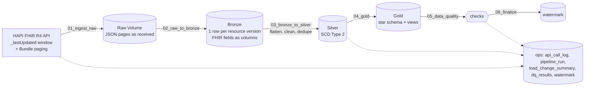

# FHIR Lakehouse on Databricks

An incremental medallion pipeline that loads Patient, Encounter, Observation and Condition resources
from the public [HAPI FHIR R4 server](https://hapi.fhir.org/baseR4) into Delta tables on Databricks.
It keeps the full change history (SCD Type 2) in Silver and serves a star schema with reporting views
in Gold. Every API call, load, change count and data-quality check is recorded in audit tables.

Runs on Databricks Free Edition (serverless, Unity Catalog). Deployed as a Databricks Asset Bundle
from this repo.

## Architecture



| Layer | Location | Contents |
|---|---|---|
| Raw | `/Volumes/fhir/raw/landing/{Resource}/{format}/load_date=…/run_id=…/page_NNNN.json` | API responses byte-for-byte |
| Bronze | `fhir.bronze.{patient,encounter,observation,condition}` | one row per resource version returned, FHIR structure kept (structs/arrays), `_`-prefixed lineage |
| Silver | `fhir.silver.*` | flattened, typed, cleaned, one version row per change (`effective_from/to`, `is_current`) |
| Gold | `fhir.gold.*` | `dim_patient`, `dim_code`, `dim_date`, three facts, five reporting views |
| Ops | `fhir.ops.*` | audit and control tables |

Table-level detail: [docs/data_model.md](docs/data_model.md). Operating the pipeline: [docs/runbook.md](docs/runbook.md).

## Repository layout

```
conf/
  pipeline_config.yaml     API, storage, resources, data-quality thresholds
  silver_mappings.yaml     Silver column -> Spark SQL expression over Bronze, per resource
notebooks/
  00_setup.py              schemas, volume, ops tables; records the run as RUNNING
  01_ingest_raw.py         one resource, one _lastUpdated window -> Raw + api_call_log
  02_raw_to_bronze.py      Raw pages of one run -> Bronze
  03_bronze_to_silver.py   flatten/clean/dedupe -> SCD2 merge -> load_change_summary (has rebuild mode)
  04_gold.py               star schema + views (full rebuild)
  05_data_quality.py       checks -> dq_results; fails the run on correctness errors
  06_finalize.py           advance watermarks + close the run (or mark it FAILED)
  lib/                     shared helper notebooks, included with %run
  tests/test_scd2.py       SCD2 merge test on Databricks (synthetic batches, scratch table)
resources/fhir_pipeline.job.yml   the Workflow (pipeline as code)
tests/                     local unit tests (pytest)
```

Pipeline notebooks are thin: they read parameters and call functions from `notebooks/lib`. The helpers
are notebooks so they can be shared with `%run`, and are also plain Python files, so `tests/` imports
them directly.

## Running it

Prerequisites: Databricks CLI authenticated to the workspace, catalog `fhir` created.

```bash
databricks bundle deploy

# initial backfill: one run per day, oldest first (SCD2 history depends on load order)
databricks bundle run fhir_pipeline --params start_date=2026-10-10
databricks bundle run fhir_pipeline --params start_date=2026-10-11
databricks bundle run fhir_pipeline --params start_date=2026-10-12

# afterwards: incremental from the watermark (also what the paused daily schedule runs)
databricks bundle run fhir_pipeline
```

Job parameters: `catalog`, `start_date`, `end_date` (exclusive, default start + 1 day), `format`
(`json`|`xml`), `run_id` (defaults to the Databricks job run id).

Tests: `uv run pytest` locally (API client, pagination, mappings, DQ and Gold definitions); run
`notebooks/tests/test_scd2` in the workspace for the SCD2 merge itself.

## Workflow

```
setup → ingest_patient → ingest_encounter → ingest_observation → ingest_condition
           ↓                  ↓                    ↓                    ↓
        bronze_*  →  silver_*  (per resource, as soon as its ingest finishes)
                                   ↓ (all four)
                                 gold → data_quality → finalize
        mark_failed  (run_if: AT_LEAST_ONE_FAILED, depends on every task)
```

Ingestion follows the required order Patient → Encounter → Observation → Condition. Each resource
reuses the same notebooks with a different `resource` parameter. Ingest tasks retry once, and the job
has a timeout, failure email and `max_concurrent_runs: 1`.

## Design decisions

**Incremental extraction.** Each run requests `_lastUpdated=ge{start}&_lastUpdated=lt{end}&_sort=_lastUpdated`
and follows the Bundle's `next` links sequentially (HAPI paging tokens expire, so no parallel paging).
Without `start_date`, the window starts at `ops.watermark` minus a 10-minute overlap. The overlap
re-reads a few records, and the Silver hash comparison absorbs them. Retries use exponential backoff
on 429/5xx. `max_pages_per_window` (50) caps a window, and a hit is logged as `TRUNCATED`. The
busiest day observed had 14 pages.

**Watermarks only move on full success.** `finalize` runs only if every task, including data
quality, succeeded, and never moves a watermark backwards. A failed run leaves it untouched, so the
next run re-reads the same window.

**Bronze keeps the FHIR structure.** Pages are read with Spark's JSON reader, so top-level FHIR
fields become columns and nested parts stay as structs/arrays. Leaf values are kept as strings
(`primitivesAsString`), so a field that looks numeric one day and decimal the next can't break the
schema. Silver casts them. New fields are added by schema evolution. The exact payload remains in
the Raw volume. Rerunning a `run_id` replaces that run's rows (`replaceWhere`), so reruns never
duplicate.

**Config-driven Silver.** `conf/silver_mappings.yaml` maps each Silver column to a Spark SQL
expression over Bronze, a type and an optional rule. Adding a column is a YAML change. Casts use
`try_cast`, so bad values become NULL instead of failing the run. Blanks become NULL, references
become IDs (`Patient/123` → `123`), and implausible dates (future, before 1900) are nulled. A path
missing from a batch loads as NULL. Rows without a business key go to `silver.<resource>_quarantine`.

**SCD Type 2.** Each batch is deduplicated to the latest version per key, and a SHA-256 hash of the
business columns decides whether anything changed:

- **New keys** are inserted.
- **Changed keys** have the current version closed and a new one inserted.
- **Unchanged keys** are ignored.
- **Late arrivals:** a version older than the current one doesn't replace it.

`effective_from` is the source's `meta.lastUpdated`, which is business time. `_silver_loaded_at`
keeps system time. Counts per run go to `ops.load_change_summary`.

**Why the backfill shows no changed records.** HAPI's `_lastUpdated` search returns only a record's
current version. A record edited on 10 Oct and again on 12 Oct only appears in the 12 Oct window. So
three separate past-day windows can never contain the same record twice, and all loads count as new.
That's a property of the source, not of the pipeline. Changes appear when records are re-read after
they change: daily incremental runs, or overlapping windows. `notebooks/tests/test_scd2` proves the
merge with synthetic insert / change / no-change / late-arrival batches.

**Gold uses the history.** Facts join to the patient version valid at the event time. If the event
predates every version held (a 2020 lab result for a patient last updated in 2026), they fall back
to the current version. If the patient was never loaded, they go to the Unknown member
(`patient_sk = -1`). `patient_match` records which case applied. Unknown members keep facts instead
of dropping them. The alternative, fetching child resources only for loaded patients
(`?subject=Patient/…`), gives tighter integrity but far more API calls.

**Data quality has two severities.** Correctness checks are `error`: a FAIL fails the run and holds
the watermark. They cover duplicate current versions, broken validity windows, Silver keys missing
from Bronze, API-vs-Bronze counts, and Gold-vs-Silver counts. Completeness checks are `warn`: null
rates and the unknown-patient rate. The public server holds a lot of incomplete test data, and that
shouldn't stop the pipeline. Thresholds live in `conf/pipeline_config.yaml`.

**PySpark instead of Dataflow Gen2.** Dataflow Gen2 is a Microsoft Fabric tool. On Databricks the
Silver transforms are PySpark/Spark SQL. Lakeflow Declarative Pipelines (`AUTO CDC`) could replace
the hand-written SCD2 merge. It was written by hand here to make the mechanics explicit.

## Known limitations

- XML: `01_ingest_raw` fetches and stores XML (`format=xml`), but Bronze currently loads JSON pages only.
- Gold is fully rebuilt each run. That's fine at this volume; at scale, facts would be merged incrementally.
- The HAPI server is a shared public test server: data volume and content vary day to day, and some
  values are junk (e.g. swapped blood pressure components).
