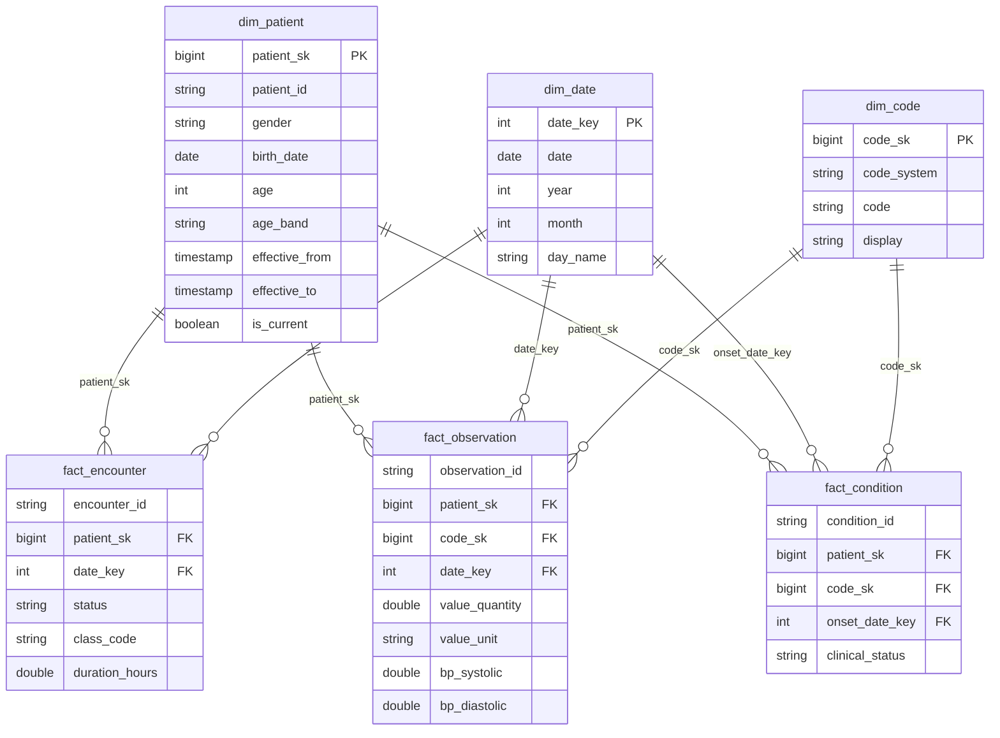

# Data model

All tables are Delta tables in Unity Catalog under the `fhir` catalog (configurable via the `catalog`
job parameter).

## Raw — `/Volumes/fhir/raw/landing`

```
{Resource}/{json|xml}/load_date=YYYY-MM-DD/run_id={run_id}/page_0001.json
```

One file per API page, exactly as returned (a FHIR `searchset` Bundle). `load_date` is the date of the
window loaded, so each daily backfill lands in its own folder.

## Bronze — `fhir.bronze.{patient, encounter, observation, condition}`

**Grain:** one row per resource version returned by the API, per run. Append-only across runs.

| Columns | Description |
|---|---|
| FHIR top-level fields (`id`, `meta`, `name`, `subject`, `code`, …) | as returned; nested elements are structs/arrays, leaf values strings |
| `_source_file` | raw page the row came from |
| `_run_id` | pipeline run |
| `_extracted_at` | when the API call returning this row started |
| `_api_url` | full request URL including parameters |
| `_load_date` | window date |
| `_loaded_at` | Bronze load time |

## Silver — `fhir.silver.*`

**Grain:** one row per version of each business key (SCD Type 2). Columns come from
`conf/silver_mappings.yaml`. Every table also has:

| Column | Description |
|---|---|
| `source_version_id`, `source_last_updated` | FHIR `meta.versionId` / `meta.lastUpdated` |
| `record_hash` | SHA-256 of the business columns; drives change detection |
| `effective_from` | when this version became valid (source `lastUpdated`) |
| `effective_to` | when it was superseded; NULL for the current version |
| `is_current` | exactly one `true` per key |
| `_run_id`, `_extracted_at`, `_load_date`, `_silver_loaded_at` | lineage |

| Table | Key | Business columns |
|---|---|---|
| `patient` | `patient_id` | active, gender, birth_date, family_name, given_name, phone, address_line, city, state, postal_code, country, marital_status, deceased_flag, deceased_datetime |
| `encounter` | `encounter_id` | patient_ref, patient_id, status, class_code, type_code, type_display, period_start, period_end, service_provider |
| `observation` | `observation_id` | patient_ref, patient_id, encounter_id, status, category, code, code_system, code_display, effective_datetime, value_quantity, value_unit, value_string, value_code, bp_systolic, bp_diastolic |
| `condition` | `condition_id` | patient_ref, patient_id, encounter_id, clinical_status, verification_status, category, code, code_system, code_display, onset_datetime, recorded_date |

`<table>_quarantine` holds rows rejected for a missing business key, with `_quarantine_reason`.

Example: patients with history

```sql
SELECT patient_id, family_name, city, effective_from, effective_to, is_current
FROM fhir.silver.patient
WHERE patient_id IN (SELECT patient_id FROM fhir.silver.patient GROUP BY 1 HAVING count(*) > 1)
ORDER BY patient_id, effective_from;
```

## Gold — `fhir.gold.*`



| Object | Grain | Notes |
|---|---|---|
| `dim_patient` | patient version | every SCD2 version; `patient_sk = xxhash64(patient_id, effective_from)`; Unknown member `-1` |
| `dim_code` | code system + code | most-used display per code (sources spell displays differently); Unknown `-1` |
| `dim_date` | calendar day | covers every event date up to today |
| `fact_encounter` | current encounter | `duration_hours`, `patient_match` |
| `fact_observation` | current observation | values, units, blood pressure components, `patient_match` |
| `fact_condition` | current condition | onset and recorded date keys, `patient_match` |
| `vw_patient_360` | current patient | encounter / observation / condition counts, active conditions, last activity |
| `vw_daily_clinical_activity` | day | encounters, observations, condition onsets by event date |
| `vw_top_conditions` | condition code | occurrences, distinct patients, active occurrences |
| `vw_patient_vitals` | patient | latest heart rate, weight, height, BMI, HbA1c, glucose, systolic / diastolic BP |
| `vw_pipeline_health` | run × resource | API calls, failures, truncations, records fetched, new / changed / unchanged |

`patient_match` on facts is `point_in_time` (patient version valid at event time), `current` (event
predates the versions held) or `unknown` (patient never loaded).

Facts use liquid clustering on `patient_sk` and the date key.

## Ops — `fhir.ops.*`

| Table | Grain | Written by |
|---|---|---|
| `api_call_log` | API page request | `01_ingest_raw`: URL, params, HTTP status, call start/end, entries, next link, file path, `file_saved_at`, status (`SUCCESS` / `TRUNCATED` / `FAILED`), error |
| `pipeline_run` | job run | `00_setup` (RUNNING) and `06_finalize` (SUCCEEDED / FAILED, `ended_at`), with parameters |
| `watermark` | resource | `06_finalize`: newest `meta.lastUpdated` loaded by a fully successful run |
| `load_change_summary` | run × resource | `03_bronze_to_silver`: records in batch, new, changed, unchanged, closed versions |
| `dq_results` | run × check | `05_data_quality`: metric, threshold, PASS / WARN / FAIL |
